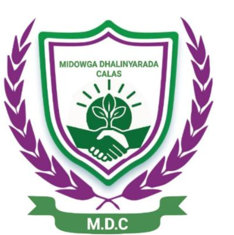

# Midawga Dhalinyarada Calas

Blood donor management application built with React, Vite, Tailwind CSS, Neon PostgreSQL, and Vercel Functions.

## Live app

[Open the application](https://calas.caqilalan.workers.dev/)

## Cloudflare Workers deployment

This project can be deployed as one Cloudflare Worker that serves both the Vite
frontend and the `/api/*` routes.

1. Run `npx wrangler login`.
2. Add the server secrets:
   - `npx wrangler secret put DATABASE_URL`
   - `npx wrangler secret put JWT_SECRET`
3. Deploy with `npm run deploy`.
4. Open `https://YOUR-WORKER-NAME.workers.dev/api/health`.

The health response should show `databaseConfigured` and `jwtConfigured` as
`true`. Do not put secrets in `wrangler.toml` or commit them to Git.

<p align="center">
  
</p>

## Setup

1. Create a Neon PostgreSQL database.
2. Run `neon/schema.sql` in the Neon SQL Editor.
3. Copy `.env.example` to `.env.local`.
4. Set `DATABASE_URL` and a long random `JWT_SECRET`.
5. Run `npm install`.
6. Run `npm run dev`. It builds the app, starts the Neon API, and opens `http://127.0.0.1:4173` automatically.
7. Set `NO_BROWSER=1` to disable automatic browser opening.

Create or reset an administrator with:

```powershell
npm run create-admin -- ADMIN_EMAIL YOUR_PASSWORD "ADMIN_NAME"
```

## Usage

- Admin: view, add, edit, and delete donors, and manage users.
- Staff: view, add, and edit donors.
- New accounts are activated when an administrator creates them.

## Security

- Authentication uses signed HTTP-only cookies and bcrypt password hashes.
- The Neon database URL and JWT secret are server-only environment variables.
- Inputs are validated in the app and database.
- `.env.local` is excluded from GitHub by `.gitignore`.
